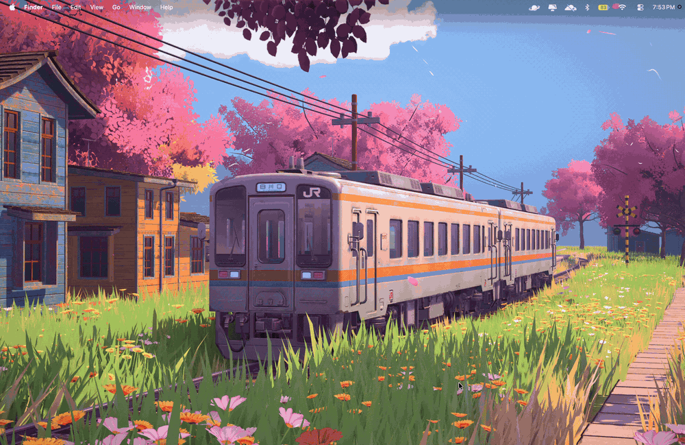
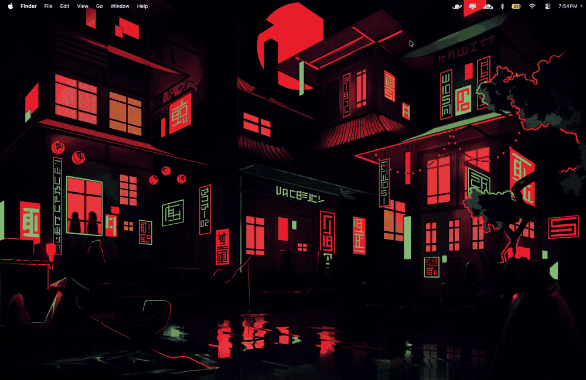

# walle

**A Linux-style wallpaper picker for macOS.**

If you have used hyprpaper, swww, swaybg, or one of the Quickshell wallpaper pickers on
Hyprland, Sway or Niri, this is the macOS equivalent. Press a hotkey and a row of slanted
wallpaper cards appears over your desktop; move with the arrow keys; press Enter and it becomes
your wallpaper, permanently.

macOS has nothing like those tools. The built-in route is System Settings, which is a dialog.
Every third-party wallpaper app is a GUI with a menu bar icon, a preferences pane, and a process
that stays resident whether you are using it or not. walle is the opposite:

- **Two small binaries** — 484 KB and 616 KB, no dependencies, nothing installed at runtime
- **No UI besides the picker** — no dock icon, no menu bar item, no preferences window
- **No background process** — zero processes and zero CPU when the picker is closed
- **Keyboard first** — configured from the command line, driven from the keyboard
- **Quick** — ~170 ms from hotkey to window, ~85 MB while open

### Coming from a Linux setup

| On Hyprland / Sway / Niri you would use | Here |
| --- | --- |
| `swww img <file>`, `hyprctl hyprpaper wallpaper …` | `walle set <file>` |
| a rofi / walker / Quickshell picker | `walle`, or a hotkey bound to it |
| a keybind that steps to the next wallpaper | `walle next` / `walle prev` / `walle random` |
| `~/.config/hypr/hyprpaper.conf` | `~/.config/walle/config` |
| `swww-daemon` and friends | nothing — no daemon runs at all |

---

## What it looks like

**Resting.** Five cards side by side, each a parallelogram leaning left, all fully opaque. The
centred card is taller than the rest and carries a thin orange border.

**Preview.** The centred card straightens into a rounded rectangle showing the wallpaper
undistorted. It is deliberately *shorter* than its neighbours, which slide outward and fade to
6% so nothing competes with the preview.

The two states are 350 ms apart, with width, skew and height animating together so it reads as
one shape changing.

---

## Requirements

- macOS 14 or later (developed on macOS 27)
- Xcode or the Command Line Tools
- skhd, if you want a global hotkey

No runtime dependencies. Both binaries are self-contained.

---

## Install

### 1. Build and install

    git clone https://github.com/AdvayGujar/walle.git
    cd walle
    ./scripts/build.sh && ./scripts/install.sh

Installs to `~/.local/share/walle` and symlinks `walle` into `~/.local/bin`. If that is not on
your `PATH` the installer prints the line to add. Other options: `--prefix DIR`,
`--bin-dir DIR`, `--dry-run`, and `./scripts/uninstall.sh`.

### Packaging

`build.sh` and `install.sh` both take `--prefix DIR`, and `install.sh --packager` keeps every
write inside that prefix — no `~/.local`, no `~/.config`, no `PATH` changes, no prompts, and
never `sudo`:

    ./scripts/build.sh --prefix "$(brew --prefix)/Cellar/walle/1.0.0"
    ./scripts/install.sh --packager --prefix /opt/homebrew/Cellar/walle/1.0.0

Build `--version VER` (or `WALLE_VERSION=VER`) stamps the app. It exists because a packager
building from a release tarball has no `.git`, so the tag cannot be read there. The version
lives in one place, `Sources/WalleCore/WalleVersion.swift`, and `build.sh` fails if the built
binary does not report the version it just stamped.

### 2. Point it at your wallpapers

    walle add ~/Pictures/Wallpapers      # creates the directory if needed
    walle dirs                           # what is configured

### 3. Build the thumbnail cache

    walle cache

Optional but recommended, so the picker never decodes an image while opening. It sizes the
thumbnails for your display automatically — there is nothing to tune.

### 4. Set up the hotkey

**Grant Accessibility first.** skhd aborts immediately without it, and launchd silently restarts
it, so it looks like it is running while doing nothing.

    brew install koekeishiya/formulae/skhd

Then add skhd to **System Settings → Privacy & Security → Accessibility** — click **+**, press
**⌘⇧G**, type `/opt/homebrew/bin/skhd`, add it and switch it on. It will not appear there by
itself, because it exits before macOS can prompt. After a `brew upgrade skhd` the grant is lost
and you must remove and re-add it.

    skhd --start-service

Add the binding **once** — two bindings make the hotkey run walle twice, and the second instance
immediately closes the first:

    grep -q walle ~/.config/skhd/skhdrc || echo 'cmd + alt - w : ~/.local/bin/walle' >> ~/.config/skhd/skhdrc
    skhd --reload

    walle doctor        # checks all of the above, plus config, library and cache

A bare `walle` opens the picker, which is what a hotkey should run. If you would rather not run
skhd at all, a macOS Shortcut can run `~/.local/bin/walle` instead — no extra process, slightly
slower launch.

---

## Using it

### Keyboard

| Key | Action |
| --- | --- |
| Left / Right (or Up / Down) | Move between wallpapers, wrapping forever |
| Space | Expand the centred card into the preview, or collapse it |
| Enter | Apply the centred wallpaper and close |
| Escape | Close without changing anything |

Keyboard only, by design. Applying writes through the public AppKit API, so it persists across
reboots. History is recorded only *after* it succeeds.

Note: macOS keeps the desktop picture **per Space**, so applying a wallpaper changes the desktop
you are looking at. See [Wallpapers and Spaces](#wallpapers-and-spaces) below.

### Commands

    walle                       Open the picker
    walle next | prev | random  Apply the next, previous or a random wallpaper
    walle set <path>            Apply a specific file
    walle set --last            Re-apply the most recent one that still exists
    walle set --dry-run ...     Show what would be applied, change nothing
    walle current               Print the current desktop wallpaper

    walle list                  List wallpapers that were found
    walle dirs                  Show configured directories and their counts
    walle add | remove | use    Change the directory list
    walle cache [--prune|--rebuild]

    walle history [--limit N] [--clear]

    walle spaces                Show the mode, live Spaces and stale entries
    walle spaces on | off       Apply every wallpaper to every Space, or not
    walle spaces all            Copy the current wallpaper onto every Space now
    walle spaces all --prune    Also drop entries for Spaces you deleted

    walle config list|get|set|unset|edit|path
    walle doctor                Check the install end to end
    walle version               Print the version (also --version)
    walle help

Most commands accept `--json`. `list` also takes `--limit N`, `--sort name|mtime|random` and
`--dir PATH`. Exit codes: **0** applied, **1** error, **2** dismissed, **3** already running.

### Wallpapers and Spaces

**macOS stores the desktop picture per Space**, and the only public API for setting it writes the
Space you are currently on. So applying a wallpaper changes the desktop you are looking at and
leaves your other Spaces alone. System Settings behaves in exactly the same way — this is not
something walle gets wrong.

If you would rather one wallpaper covered every Space, turn that on once:

    walle spaces on     # every wallpaper you pick from now on goes to every Space
    walle spaces off    # back to only changing the Space you are on (the default)

`spaces on` brings the Spaces you already have into line immediately, and remembers the setting
in your config file as `spaces = all`. It then covers every apply path: the picker (including the
hotkey), `walle set`, and `next` / `prev` / `random`. Because macOS persists a wallpaper change
asynchronously, the sync waits for the system's own write to land before it copies the wallpaper
to the other Spaces, so the result is not reverted a moment later.

    walle spaces               # the mode, the live Spaces, and any stale entries
    walle spaces all           # sync now, without changing the mode
    walle spaces all --prune   # also drop entries for Spaces you have deleted

macOS never tidies up after a deleted Space, so the store slowly fills with entries for Spaces
that no longer exist — while a Space created since you last applied a wallpaper has no entry at
all and keeps showing whatever it had. That is why the sync compares the store against the list
of Spaces that *actually exist* rather than trusting the store's own keys.

This writes macOS's private wallpaper store, so walle backs the file up first (as
`Index.plist.walle-backup`) and restarts `WallpaperAgent` so the change takes effect. Nothing is
permanently removed unless you pass `--prune`.

---

## Configuration

`~/.config/walle/config` — plain `key = value`, no GUI. Geometry is in design units for a
1920-wide screen and is scaled to your display automatically.

| Key | Default | |
| --- | --- | --- |
| design_width | 1920 | screen width the units are authored against |
| slots | 5 | cards in the row; must be odd |
| card_width | 280 | card width at the vertical centre |
| card_height | 420 | neighbouring card height |
| card_gap | 10 | gap between cards at rest |
| selected_card_height | 540 | height of the centred card while resting |
| expanded_card_width | 880 | preview rectangle |
| expanded_card_height | 400 | preview rectangle |
| card_skew | -0.25 | lean; negative leans left, 0 is upright |
| card_corner_radius | 12 | constant across the morph |
| card_border_width | 3 | border on the selected card |
| card_border_color | FF9F0A | hex |
| row_center_y_frac | 0.5 | row position, 0 = bottom |
| dim_alpha | 0.35 | backdrop darkness |
| dim_falloff | 0 | per-step fade of the resting row; 0 = fully opaque |
| dim_floor | 0.35 | lowest alpha the fade reaches |
| expanded_neighbour_alpha | 0.06 | opacity of everything but the preview |
| animation_ms | 350 | morph and one rotation step |
| expand_on_enter | true | open resting rather than already expanded |
| wallpaper_dirs | ~/Downloads/wallpaper | colon-separated roots; write a literal `:` as `\:` |
| recursive | true | descend into subdirectories |
| sort | name | name, mtime or random |
| apply_to | all | all screens, or the one under the pointer |
| fill_mode | fill | fill, fit, stretch or center |
| thumb_max_px | 1600 | manual floor for thumbnail size; see below |

### Some useful settings

    walle config set card_skew -0.4            # more slanted
    walle config set card_skew 0               # upright rectangles
    walle config set animation_ms 180          # snappier
    walle config set slots 7                   # more cards (must be odd)
    walle config set apply_to active           # only the screen under the pointer
    walle config set fill_mode fit             # show the whole image
    walle config set dim_falloff 0.2           # fade the resting row
    walle config set dim_alpha 0               # no backdrop dimming

`walle config list` shows everything; `walle config unset <key>` restores one default.

**On thumbnail size:** you never need to set it. The picker derives what the cards need from
their geometry, your display and your widest wallpaper, and `walle cache` asks the picker for
that value before building, so the two always agree. `thumb_max_px` only acts as a manual floor
if you want more resolution than the geometry requires.

**On the config file:** it is written once by the installer and is authoritative from then on,
so changing a default in a new version will not reach it. That is deliberate — your settings
survive upgrades. Editing commands (`config set/unset`, `dir add/remove/use`) change only the
line for the setting involved, so comments and your own key order survive too.

---

## Troubleshooting

**The hotkey does nothing, or `skhd --reload` says "could not locate existing instance".**

skhd is not running. It exits immediately without Accessibility permission, and launchd quietly
restarts it, so it looks alive while doing nothing. Its explanation is one line in a log:

    cat /tmp/skhd_$(whoami).err.log      # "must be run with accessibility access! abort.."

Fix: `skhd --stop-service`, grant Accessibility as in step 4 above, then
`skhd --start-service && skhd --reload`. `walle doctor` detects this for you.

**The picker flashes open and closes immediately.**

Two bindings in `~/.config/skhd/skhdrc`. Keep exactly one, then `skhd --reload`. `walle doctor`
reports duplicates.

**The picker opens but the keyboard does nothing.**

Different problem: skhd is fine but the window is not key. walle asks for focus on launch; if
another app steals it, click once on the overlay.

**No wallpapers appear.** Check `walle dirs` and `walle list`. A missing directory warns but does
not stop the others being scanned.

**History is empty.** walle writes it only after the wallpaper actually changed, and reports a
permission failure rather than swallowing it.

**Something looks wrong with the layout.**

    walle-picker --snapshot /tmp/shot.png --collapsed
    walle-picker --snapshot /tmp/mid.png --transition 0.5
    walle-picker --dump-geometry

---

## How it works

Two binaries, and the split is deliberate.

`walle` is the CLI. It never links AppKit, so it starts in single-digit milliseconds. Anything
needing the window server — the picker, applying a wallpaper, reading the current one — it hands
to `walle-picker`, which is the only binary that links AppKit and lives in `Walle.app` with
`LSUIElement` set to stay out of the dock.

The geometry lives in `LayoutEngine`, which is pure, has no AppKit import, and is a continuous
function of a single transition value: 0 is the resting row, 1 is the expanded preview, and
every value between is a valid frame. The animation moves that one number, which is why the
shape cannot drift out of sync and why `--transition` can render any intermediate frame.

Cards are a `CAShapeLayer` path, not a shear transform. The same path is the clip mask and the
border, and the photo sits in an undistorted layer behind it.

A rotating row is a carousel: each card keeps its own wallpaper and slides to its neighbour's
slot. Thumbnails are generated with ImageIO at a bounded size; a full-resolution image is never
decoded.

    Sources/WalleCore/     Foundation only, no AppKit, fully unit tested
    Sources/WalleKit/      AppKit: window, cards, corridor
    Sources/walle/         CLI executable
    Sources/walle-picker/  GUI executable
    Tests/WalleCoreTests/  119 tests in 13 suites
    scripts/               swift.sh, build.sh, install.sh, uninstall.sh
    tools/                 offscreen geometry diagnostics

---

## Performance

On Apple silicon with a 1512x982 Retina display and a 5-image library (re-measured after the
Spaces work):

| Metric | Value |
| --- | --- |
| `walle` binary, stripped | 484 KB |
| `walle-picker` binary, stripped | 616 KB |
| CLI start | ~10 ms |
| Picker: process start to window | ~170 ms |
| Peak memory | ~85 MB picker, ~7 MB CLI |
| Processes alive when closed | 0 |

About 65 ms of the cold start is the OS loading AppKit before any walle code runs, and about
22 MB of the memory is the full-screen Retina backing store needed to dim the screen. Both are
inherent to being a full-screen overlay. The rest of the memory is decoded thumbnails: this
display's card geometry requires 1837-px thumbnails, and several are resident at once. The Spaces
feature itself runs in the `walle` CLI process, not the picker, so it does not affect these
numbers.

---

## Development

    ./scripts/swift.sh test              # 119 tests in 13 suites
    ./scripts/swift.sh build -c release
    ./scripts/clean.sh                   # reclaim disk

Use `scripts/swift.sh` rather than bare `swift`: it redirects the SwiftPM and clang caches into
`.build` and disables SwiftPM's own sandbox. Harmless otherwise.

`tools/` has the offscreen diagnostics; see `tools/README.md`. `--debug-tiles` fills each card
with a flat colour so compositing order inside an overlap can be read objectively — that is how
a bug where paint order disagreed with `zPosition` was found.

---

## Non-goals

No video or live wallpapers, no online search, no colour filtering, no menu bar item, no
auto-rotation daemon. Each would mean a permanently running process or a much larger surface.

## License

MIT — see [LICENSE](LICENSE).
