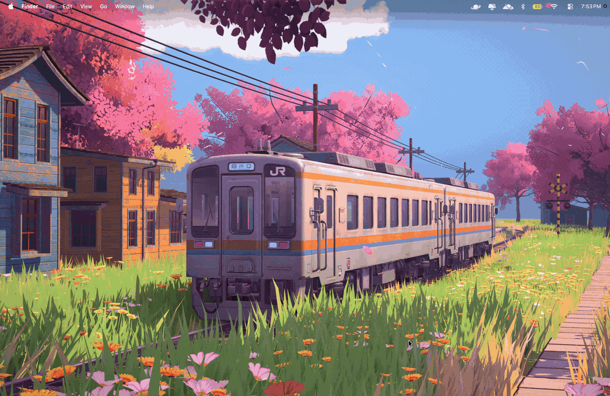

# walle

**A Linux-style wallpaper picker for macOS.**

If you have used hyprpaper, swww, swaybg, or one of the Quickshell wallpaper pickers on Hyprland,
Sway or Niri, this is the macOS equivalent. Press a hotkey and a row of slanted wallpaper cards
appears over your desktop; move with the arrow keys; press Enter and it becomes your wallpaper,
permanently.

- **Three small binaries** — CLI, picker and the replaceable ML backend; no runtime
  dependencies for normal use
- **No UI besides the picker** — no dock icon, no menu bar item, no preferences window
- **No daemon** — zero processes and zero CPU unless you are running the picker,
  `walle rotate`, or a cache fill (which exits when done)
- **Keyboard first** — configured from the command line, driven from the keyboard
- **Quick** — ~130 ms from hotkey to window, ~95 MB while open



Pressing Space straightens the centred card into an undistorted preview; the second recording is
[here](docs/preview.gif).

### Coming from a Linux setup

| On Hyprland / Sway / Niri you would use | Here |
| --- | --- |
| `swww img <file>`, `hyprctl hyprpaper wallpaper …` | `walle set <file>` |
| a rofi / walker / Quickshell picker | `walle`, or a hotkey bound to it |
| a keybind that steps to the next wallpaper | `walle next` / `walle prev` / `walle random` |
| `~/.config/hypr/hyprpaper.conf` | `~/.config/walle/config` |
| `swww-daemon` and friends | nothing — no daemon runs at all |

## Install

macOS 14 or later, and [skhd](https://github.com/koekeishiya/skhd) if you want a global hotkey.

```sh
brew install AdvayGujar/tap/walle
walle add ~/Pictures/Wallpapers      # or any directory of images
walle cache                          # optional, but makes the picker open instantly
```

The formula builds from source on install, so it also needs Xcode 16 or the matching Command
Line Tools for Swift 6. Prefer a checkout? The installer does the same thing by hand:

```sh
git clone https://github.com/AdvayGujar/walle.git
cd walle
./scripts/install.sh                 # builds, installs, and links ~/.local/bin/walle
```

A bare `walle` opens the picker — that is what a hotkey should run. `walle doctor` checks the
install end to end. Packaging (`--prefix`, `--packager`), the skhd Accessibility setup, and every
installer flag are in **[docs/INSTALL.md](docs/INSTALL.md)**.

## Using it

| Key | Action |
| --- | --- |
| Left / Right (or Up / Down) | Move between wallpapers, wrapping forever |
| Space | Expand the centred card into the preview, or collapse it |
| Enter | Apply the centred wallpaper and close |
| Escape | Close without changing anything |

```sh
walle                      # open the picker
walle next | prev | random # apply the next, previous or a random wallpaper
walle rotate 10m           # change wallpaper every 10 minutes until Ctrl-C
walle upscale on           # cache ML copies behind the library, hidden
walle upscale --all        # ML-upscale to HEIC, originals untouched
walle set <path>           # apply one file; --last re-applies the newest that still exists
walle current              # print the current desktop wallpaper
walle list | dirs          # what was found, and where
walle add | remove | use   # change the directory list
walle cache [--prune|--rebuild]
walle spaces [on|off|all] [--dry-run] [--prune]
walle config list|get|set|unset|edit|path
walle history [--limit N] [--clear]
walle doctor
```

Every command, `--json`, and the exit codes are in **[docs/USAGE.md](docs/USAGE.md)**.

ML upscaling uses a replaceable `walle-upscaler` backend. The default is Real-ESRGAN
**x4plus** through Upscayl's `upscayl-bin`; install Upscayl or point `upscale_tool` /
`upscale_models` at the binary and model files. `walle upscale on` caches in the background
and returns immediately; the picker stays usable, new images and directories are picked up
automatically, and cached copies replace the originals once ready. Custom models and the
job/result contract are in **[docs/UPSCALING.md](docs/UPSCALING.md)**.

## Two pieces of macOS worth knowing

**Wallpapers are per Space.** The public API only writes the Space you are on, so that is what an
apply changes. `walle spaces on` makes every apply cover every Space; `walle spaces all --dry-run`
shows what that would do without writing anything. Details: [docs/SPACES.md](docs/SPACES.md).

**The config is a file.** `~/.config/walle/config`, plain `key = value`, created once and then
authoritative. `walle config list` prints every current value. Details:
[docs/CONFIGURATION.md](docs/CONFIGURATION.md).

## Documentation

| | |
| --- | --- |
| [Install and packaging](docs/INSTALL.md) | build, prefixes, packager mode, hotkey |
| [Usage](docs/USAGE.md) | commands, JSON, exit codes |
| [Configuration](docs/CONFIGURATION.md) | every key, defaults, examples |
| [Wallpapers and Spaces](docs/SPACES.md) | per-Space behaviour, dry run, prune |
| [Upscaling](docs/UPSCALING.md) | ML backend, custom models, HEIC, measured comparison |
| [Troubleshooting](docs/TROUBLESHOOTING.md) | hotkey, focus, empty library, stale Spaces |
| [How it works](docs/HOW-IT-WORKS.md) | the three binaries, geometry, thumbnails |
| [Performance](docs/PERFORMANCE.md) | measurements and method |
| [Development](docs/DEVELOPMENT.md) | tests, tools, release process |

## Non-goals

No video or live wallpapers, no online search, no colour filtering, no menu bar item, no
persistent daemon. `walle rotate` only runs while you are running it; `walle upscale on`
starts a detached cache fill that exits when done. Each avoided feature would mean a
permanently running process or a much larger surface.

## License

MIT — see [LICENSE](LICENSE).
